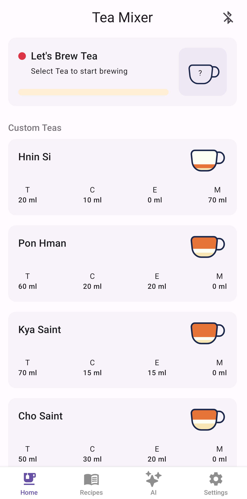
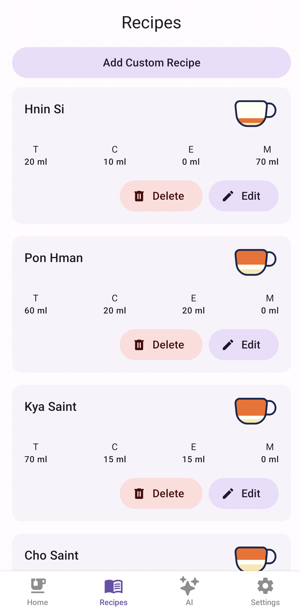
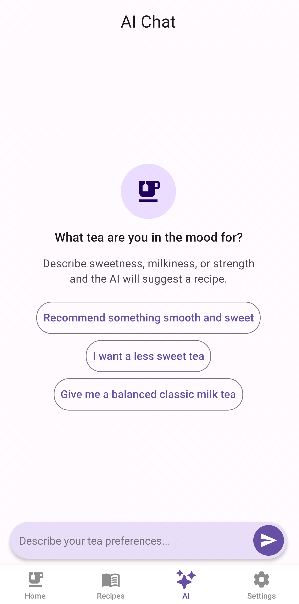
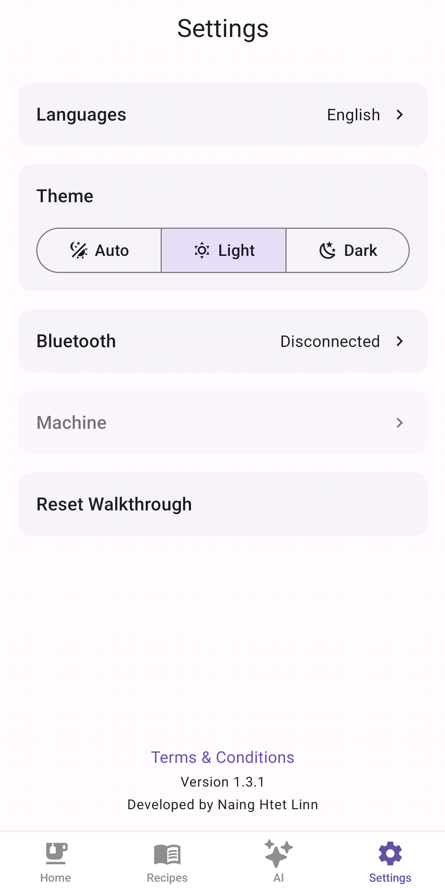

# Tea Mixer Application

A smart mobile controller for an [ESP32 Tea Mixer Machine](https://github.com/nainghtetlinn/tea-mixer-firmware), featuring real-time telemetry, hardware calibration, custom ratios, and an AI recipe assistant.

[](https://github.com/nainghtetlinn/tea-mixer-firmware)
[](https://github.com/nainghtetlinn/tea-mixer-ai-server)
## Features

* **Hardware Configuration**
    - Set maximum tea volume (mL)
    - Toggle between **Weight Mode** and **Time Mode**
    - Calibrate empty cup weight
    - Assign saved recipes to physical machine buttons

* **Live Machine Monitoring**
    - Real-time tea brewing progress
    - Live temperature and weight telemetry
    - Instant cup removal detection and mid-brew safety warnings

* **Remote Brewing & Maintenance**
    - Start tea dispensing directly from the app
    - Start and cancel automated machine cleaning cycles with live progress

* **Custom Recipes**
    - Save personal tea ingredient ratios

* **AI Tea Chat**
    - Get personalized tea recipe suggestions based on your taste

* **Localization & Themes**
    - English and Burmese language support
    - Dark mode and light mode
## Tech Stack

* **Framework:** React Native, Expo
* **State Management:**  Zustand
* **Database:** Expo SQLite, Async Storage
* **Network:** React Native BLE PLX, Axios
* **UI & Styling:** Tailwind CSS (Uniwind), React Native Paper
* **Tooling & Linting:** Biome, Lefthook, Reactotron
## Application Architecture

* **Bluetooth Service (`src/services/bluetooth/`):** Manages adapter state, discovery, connection pooling, and MTU negotiation.
* **Device Service (`src/services/device/`):** Serializes recipe payloads and parses telemetry notifications received from the microcontroller.
* **Database Layer (`src/services/database/`):** Handles offline persistence of user-created recipes using SQLite tables.
* **State Stores (`src/stores/`):** Modular Zustand stores split by domain (`bluetooth-store`, `device-store`, `tea-store`).
## Project Structure

```text
expo-tea/
├── src/
│   ├── assets/             # Fonts, icons and static media
│   ├── components/         # Reusable UI components
│   │   ├── chat/           # AI assistant views
│   │   ├── dialogs/        # Device action modals
│   │   ├── tea-card/       # Recipe list elements
│   │   └── tea-cup/        # SVG brewing animation components
│   ├── constants/          # Predefined recipe defaults and prompts
│   ├── hooks/              # Custom layout and hardware hooks
│   ├── i18n/               # Translation files (en, mm)
│   ├── screens/            # Core views (Home, Recipes, Chat, Settings)
│   ├── services/           # BLE handlers, SQLite access, API client
│   ├── stores/             # Zustand state stores
│   └── types/              # TypeScript definitions
├── app.json                # Expo configuration
├── biome.json              # Linter/formatter settings
└── package.json
```
## Environment Variables

To run this project, you will need to add the following environment variables to your .env file

```bash
# Physical device on the same local network:
EXPO_PUBLIC_API_URL=http://<YOUR_LOCAL_IP>:<PORT>
```

The AI recipe assistant relies on an external streaming backend. Please refer to the [backend repository](https://github.com/nainghtetlinn/tea-suggestion) for instructions on setting up and running the recommendation server locally.
## Run Locally

Prerequisites

- Node.js >= 18
- Expo CLI (`npm install -g expo-cli`)
- Physical iOS or Android device (recommended for Bluetooth testing; BLE simulation is limited on emulators)

1. Clone the repository
```bash
  git clone https://github.com/nainghtetlinn/tea-mixer-application
  cd tea-mixer-application
```

2. Install dependencies
```bash
  npm install
```

3. Running the App
```bash
npm start
```

## Code Quality

Linting and formatting are handled with Biome:

```bash
npm run check
npm run format
npm run lint
```

## Screenshots

### Home Screen


### Recipes Screen


### AI Chat Screen


### Setting Screen

    

## API Reference

Communication between the mobile app and the ESP32 uses JSON payloads encoded in UTF-8 (and decoded from Base64 on incoming BLE notifications).

### Outgoing Commands (`App -> ESP32`)

All outgoing commands follow the structure `{ "type": "<COMMAND_TYPE>", "payload"?: { ... } }`.

| Method | Command `type` | Payload | Description |
| --- | --- | --- | --- |
| `send.makeTea(ingredients)` | `MAKE_TEA` | `TeaIngredients` | Starts brewing a tea with the specified ingredient ratios. |
| `send.getButtonsInfo()` | `GET_BUTTONS_INFO` | *None* | Requests the saved recipes mapped to physical buttons `0`, `1`, and `2`. |
| `send.setButtonInfo(id, info)` | `SET_BUTTON_INFO` | `{ id: 1, ...ButtonInfo }` | Assigns a recipe/configuration to a specific hardware button. |
| `send.getDeviceInfo()` | `GET_DEVICE_INFO` | *None* | Requests general machine configuration and status. |
| `send.getTemperature()` | `GET_TEMPERATURE` | *None* | Requests the current water/machine temperature reading. |
| `send.getWeight()` | `GET_WEIGHT` | *None* | Requests the current load cell weight reading. |
| `send.setDispensingMode(weightMode)` | `SET_DISPENSING_MODE` | `{ weightMode: boolean }` | Toggles between **Weight Mode** (`true`) and **Time Mode** (`false`). |
| `send.setTargetTotalMl(targetTotalMl)` | `SET_TARGET_TOTAL_ML` | `{ targetTotalMl: number }` | Sets the maximum target dispensing volume in milliliters. |
| `send.startCleaning()` | `START_CLEANING` | *None* | Initiates the automated machine cleaning cycle. |
| `send.cancelCleaning()` | `CANCEL_CLEANING` | *None* | Aborts an active cleaning cycle. |

---

### Incoming Notifications (`ESP32 -> App`)

Incoming BLE notifications arrive as Base64-encoded JSON strings via `handleNotification(base64Value)` with the structure `{ "type": "<EVENT_TYPE>", "payload"?: { ... } }`.

#### Hardware & Telemetry

| Event `type` | Payload | Store Action / Behavior |
| --- | --- | --- |
| `DEVICE_INFO` | `DeviceInfo` | Updates device settings and state (`store.setDeviceInfo`). |
| `BUTTONS_INFO` | `ButtonInfo[]` | Updates stored physical button mappings (`store.setButtonInfos`). |
| `TEMPERATURE` | `{ temperature: number }` | Updates real-time temperature reading (`store.updateTemperature`). |
| `WEIGHT` | `{ weight: number }` | Updates real-time load cell weight (`store.updateWeight`). |

#### Brewing Lifecycle

| Event `type` | Payload | Store Action / Behavior |
| --- | --- | --- |
| `TEA_START` | `TeaStartPayload` | Marks brewing session as active (`store.teaStart`). |
| `TEA_PROGRESS` | `{ percentage: number, ...current }` | Updates live ingredient volumes and overall completion percentage (`store.teaProgress`). |
| `TEA_FINISH` | *None* | Resets active brewing state (`store.teaFinish`) and triggers completion toast. |
| `CUP_REMOVED` | *None* | Updates cup placement state (`store.cupRemoved`). |
| `CUP_WARNING` | *None* | Triggers safety warning (`store.cupWarning`) and alerts user that the cup was removed mid-brew. |

#### Cleaning Lifecycle & Errors

| Event `type` | Payload | Store Action / Behavior |
| --- | --- | --- |
| `CLEANING_START` | `{ durationSeconds: number }` | Starts cleaning timer state (`store.cleaningStart`) and displays toast. |
| `CLEANING_PROGRESS` | `{ progress: number, remainingSeconds: number }` | Updates cleaning progress bar and countdown (`store.updateCleaningProgress`). |
| `CLEANING_FINISHED` | *None* | Marks cleaning complete (`store.cleaningFinish`) and displays toast. |
| `CLEANING_CANCELLED` | *None* | Resets cleaning state (`store.cleaningCancel`) and displays toast. |

#### Error Events

When a command fails validation or state checks on the ESP32, the firmware emits an `ERROR` notification containing an error code and message (displayed via `snackbar.toast`):

| Error Code | Message | Trigger Condition |
| --- | --- | --- |
| `MAKE_TEA_ERROR` | `"Tea state is not in idle state"` | `MAKE_TEA` sent while the machine is already brewing or cleaning. |
| `NO_CUP` | `"No cup detected — waiting for cup placement"` | `MAKE_TEA` sent when no cup is detected on the load cell. |
| `SET_TARGET_TOTAL_ML_ERROR` | `"Invalid target ml"` | `SET_TARGET_TOTAL_ML` received an out-of-range or invalid volume. |
| `START_CLEANING_ERROR` | `"Tea state is not in idle state"` | `START_CLEANING` sent while the machine is busy. |
| `CANCEL_CLEANING_ERROR` | `"Tea state is not in cleaning state"` | `CANCEL_CLEANING` sent when no cleaning cycle is active. |
## Contributing

This project is currently private and not accepting external contributions.


## License

Copyright (c) 2026 Naing Htet Linn. All rights reserved.

This project and its source code are proprietary. Unauthorized copying, modification, distribution, or use of this software, in whole or in part, via any medium, is strictly prohibited without prior written permission from the author.